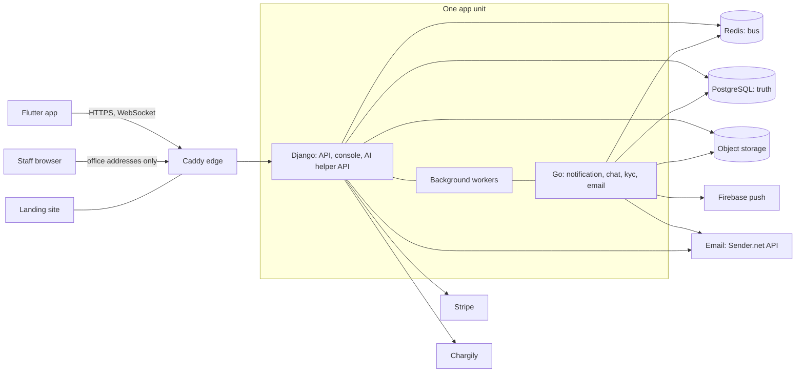
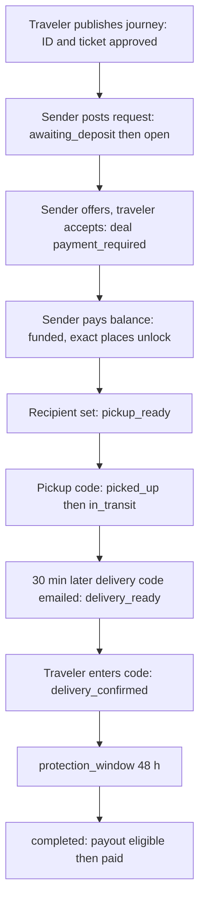
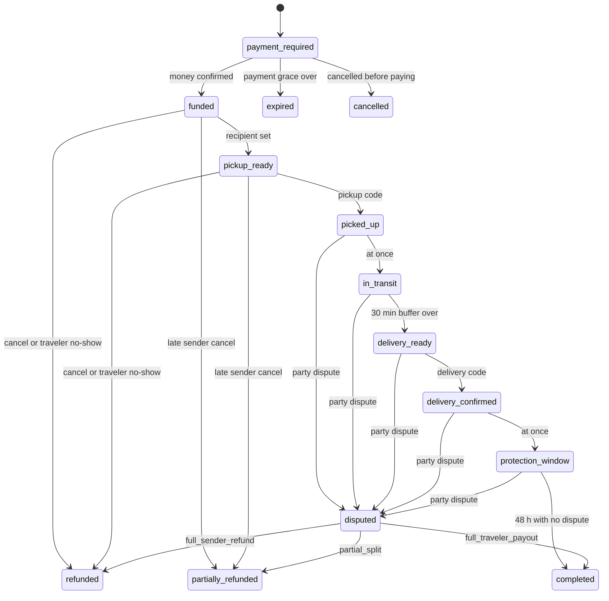
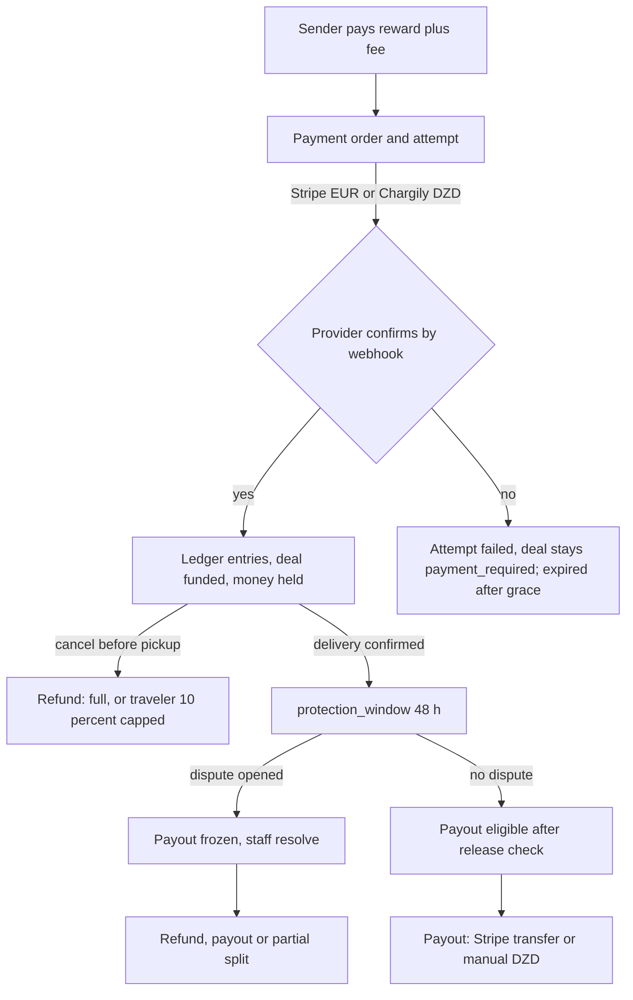
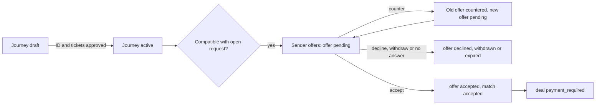
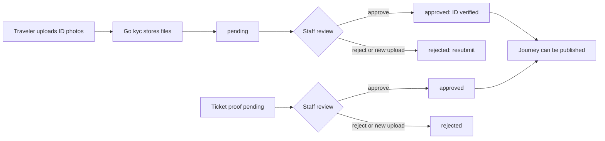
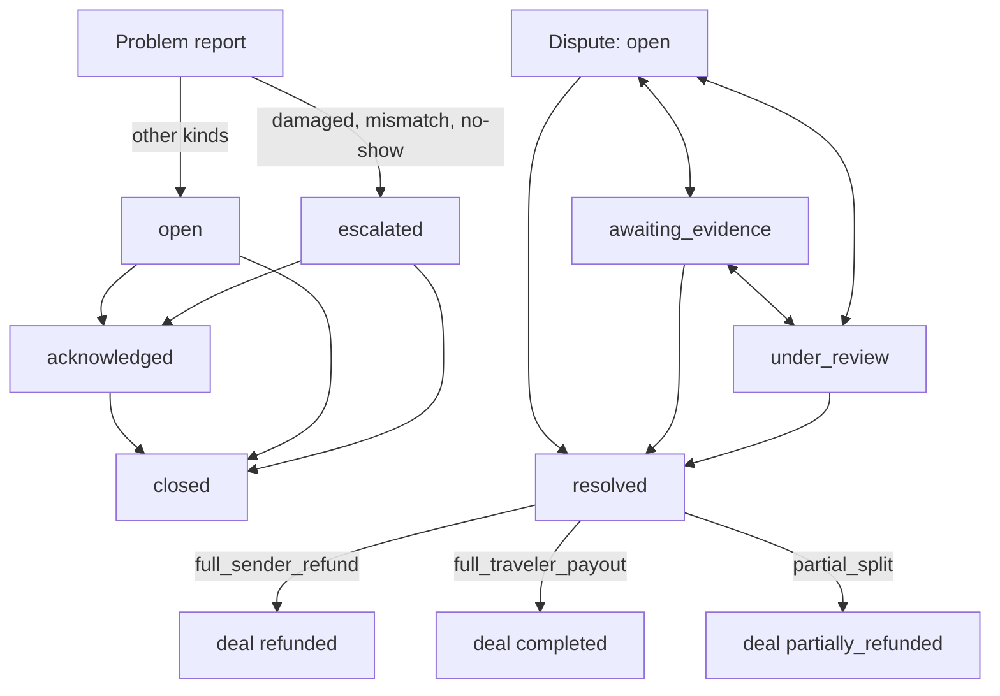
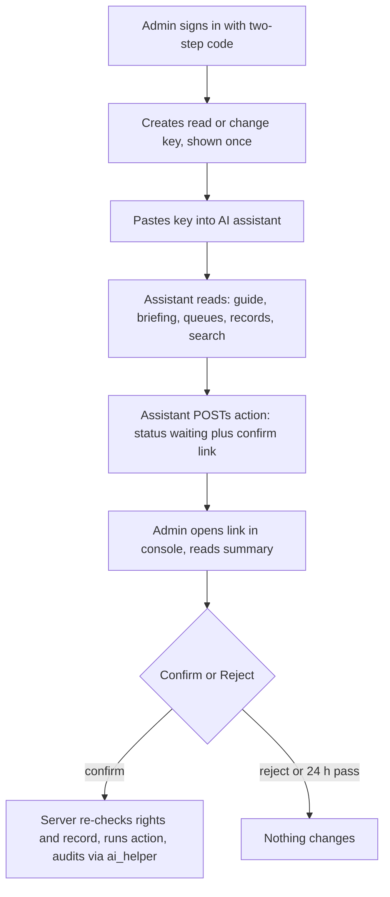

# Architecture and diagrams

Covers: How Wassla is built and how it works end to end, with ASCII and mermaid diagrams of the system, the money, the deal states, matching, verification, disputes and the staff console with the AI helper, plus where data lives, scheduled jobs and hosting.
Related files: stakeholder-questions.md (CI checks, reliability), overview-and-glossary.md (status words), deliveries.md, money.md, pricing.md, trips-and-matching.md, accounts-and-verification.md, problems-and-disputes.md, messages-and-notices.md (live updates, Go services), admin-console.md, settings-and-helper.md

## How do I present a diagram to someone?
- Answer in two or three plain sentences first, then show the diagram.
- Print the ASCII version in a code block (works in any chat or email). Then print the mermaid version in a second code block marked `mermaid` (draws a picture on GitHub or a docs page).
- The diagrams use the exact status words staff see in the console (for example `funded`, `protection_window`) and show the normal path. For exact numbers point to the named file, for example "details: money.md". Do not invent boxes that are not drawn here.

## What is Wassla on one page?
Wassla is a peer-to-peer fast-delivery marketplace. A sender posts a parcel, a traveler already going that way carries it, Wassla handles matching, payment, handover codes, a 48-hour protection period and the traveler's payout. EUR is the canonical currency; Algerian cards pay a server-converted DZD amount (details: money.md).

The parts:
| Part | What it does | Talks to |
|---|---|---|
| Flutter app (iOS, Android; `mobile/`) | What senders, travelers and recipients' links use. Tabs: Home, Deliveries, Chat, Profile; bell for notices. English, French, Arabic (right-to-left). Never decides money or status; it only shows what the server says. | Django over HTTPS; Go services over WebSocket |
| Django monolith (`backend/monolith`) | The brain. All rules, money, deals, matching, verification, disputes, the admin console and the AI helper API. One codebase, many "apps" (next section). | PostgreSQL, Redis, object storage, Stripe, Chargily, email, push |
| PostgreSQL 16 and Redis 7 | PostgreSQL is the one source of truth. Redis is a fast message bus (live events, push and email queues), not the truth: Django also saves every obligation in the database. | Django, Go |
| Go services (`backend/services`) | `notification` (live updates and push), `chat` (live chat relay), `kyc` (ID photo upload), `email` (sends queued mail). If they are down Django still works. | Redis, PostgreSQL, object storage, Firebase, Sender.net |
| Object storage (S3-compatible) | Private buckets for parcel photos, ticket proofs, dispute evidence, ID photos, payout evidence. | Django, Go kyc |
| Stripe and Chargily | Stripe: EUR cards, refunds, EUR payouts (connected accounts). Chargily: Algerian card / Edahabia, shown in DZD converted by the server from EUR. | Django (calls and webhooks) |
| Firebase push and email (Sender.net API) | Phone notices when the app is closed; verification, reset, invitation, delivery-code and status emails. Both ship switched off (server flags `FCM_ENABLED` and `EMAIL_ENABLED` default to false) until the operator turns them on. | Go notification and email; Django |
| Landing site (`web/`) | Static pages in en, fr, ar plus terms, privacy, prohibited items, support. No build step. | Served by a small web server inside the app unit, reached through the edge |
| Admin console (`/admin/`, part of Django) | Staff pages: verification, deals, disputes, payments, payouts, settings, audit. Also the AI helper pages. | Django, only from approved office addresses |
| Caddy edge | The only public door (ports 80 and 443). Adds HTTPS, hides internal routes. | App container |
<!-- src: ARCHITECTURE.md (hint), infra/vps/compose.yml, infra/vps/Caddyfile, infra/vps/launcher.py, infra/vps/stack.env.example, backend/services/cmd/*, backend/monolith/config/urls.py, config/settings/base.py, mobile/pubspec.yaml -->
ASCII diagram of the system (show this one in a code block):
```
 +----------------+   HTTPS        +-------------------+
 | Flutter app    |--------------->|   Caddy edge      |
 | (iOS/Android)  |   WebSocket    |  ports 80 / 443   |
 +----------------+<------+        +---------+---------+
 +----------------+       |                  | private
 | Staff browser  |-------+--(office IPs     |  network
 | (admin console)|          only for /admin)|
 +----------------+                          v
 +----------------+        +-----------------------------+
 | Landing site   |<-------|        ONE APP UNIT         |
 | (static pages) |        |  Django monolith (API,      |
 +----------------+        |   console, AI helper API)   |
                           |  + background workers       |
                           |  + Go: notification, chat,  |
                           |        kyc, email           |
                           +--+-------+-------+-------+--+
                              |       |       |       |
                +-------------+  +----+---+   |   +---+---------+
                v                v        v   |   v             v
          +-----------+     +---------+ +-----+--+ +-----------+
          | PostgreSQL|     |  Redis  | |Object  | | Stripe    |
          | (truth)   |     | (bus)   | |storage | | Chargily  |
          +-----------+     +---------+ |(files) | +-----------+
                                        +--------+
        Out to phones: Firebase push.  Out to inboxes: email (Sender.net).
```

Same picture in mermaid:


## What are the Django apps and what does each own?
One line per folder in `backend/monolith/apps`. A member never sees these names; staff see them only in "Technical records".
| App | Owns |
|---|---|
| `accounts` | People: sign-up, sign-in, tokens, email codes, ban state, Google and Apple links |
| `core` | Shared plumbing: business settings, policy defaults, scheduling of events, health, languages, locks that keep money steps in order |
| `kyc` | ID verification records (Go `kyc` takes uploads; Django stores and reviews) |
| `trips` | Journeys and legs, ticket proofs, leg progress, schedule changes (the old single `Trip` is history) |
| `locations`, `routing` | Canonical places, countries, sea crossings; route and distance lookups |
| `parcels` | Delivery requests, parcel details, tracking numbers |
| `matching` | Matches, offers, counters, compatibility, listed price and recommended reward |
| `deals` | The deal: frozen terms, the status machine, cancellation, no-shows, timeline |
| `finance` | The real money system: payment orders and attempts, Stripe and Chargily, refunds, ledger, payouts, guest payment links, scheduled jobs, exports |
| `handover` | Pickup and delivery codes, attempts, lockouts, rotation |
| `disputes`, `problems` | Disputes with evidence and settlement; lighter problem reports (no-show, damage, delay) |
| `ratings`, `boosts` | Two-sided blind reviews and moderation; the sender's extra reward (there is no paid boost) |
| `discovery` | Home discovery: public profiles, route alerts, "I can carry this" |
| `notifications` | Bell notices, push, email queue, delivery rules |
| `chat` | One-to-one messages between sender and traveler of a match |
| `admin_panel` | Staff identity, the five roles, the console pages, audit log, two-step sign-in, invitations |
| `admin_helper` | AI helper keys, call log, prepared changes, read API and this skill |
| `payments`, `wallet`, `verification` | Old modules (mock payments, DZD wallet, match-based codes). Not routed; history only (money.md) |
<!-- src: backend/monolith/apps/*/models.py docstrings, config/settings/base.py INSTALLED_APPS, config/urls.py -->
## How does one delivery go, from request to payout?
Short answer: sender posts and offers, traveler accepts, sender pays, parcel is handed over with a code, delivered with a second code, then 48 hours of protection, then the traveler is paid. Details: deliveries.md, money.md.
```
 SENDER                    WASSLA                       TRAVELER
 ------                    ------                       --------
 post request  ---------> request awaiting_deposit
 pay deposit   ---------> request open  <----- publishes journey
                                              (needs ID + ticket ok)
 offer reward  ---------> match + offer pending
                          (fee added on top)  <--- accept / counter
                          deal payment_required
 pay balance   ---------> deal funded  (exact places unlock)
 set recipient ---------> deal pickup_ready
 give parcel +             picked_up -> in_transit  <-- confirm pickup
  pickup code                                          with pickup code
                          delivery code buffered 30 min
                          delivery_ready  (code to recipient by email)
 RECIPIENT gives code ---> traveler enters it
                          delivery_confirmed
                          protection_window (48 h; disputes allowed)
                          completed   -> payout eligible
                          payout sent / paid  ----------> traveler paid
```

Request status path: `awaiting_deposit`, `open`, `matched`, `in_transit`, `delivered`, `completed` (side exits `cancelled`, `expired`). A deal is created straight in `payment_required`.
<!-- src: apps/parcels/models.py, apps/deals/lifecycle.py, apps/matching/models.py, overview-and-glossary.md -->
## What is the deal status machine?
Every status change happens in one place on the server (never in the app). Each change is idempotent: a replayed webhook or a double click does nothing the second time. Deadlines come from values frozen on the deal at funding, so later Settings changes do not affect a running deal.
```
 payment_required --paid--> funded --recipient set--> pickup_ready
   |  +--> expired   (1 h payment grace over, space released)
   +-----> cancelled (cancelled before paying)
 funded or pickup_ready (before pickup):
   party cancels      --> refunded (full refund)
                       or partially_refunded (late sender cancel)
   traveler no-show   --> refunded (staff record it)
   sender no-show     --> status stays (staff record it)
 pickup_ready --pickup code--> picked_up --at once--> in_transit
 in_transit --30 min buffer--> delivery_ready --code--> delivery_confirmed
 delivery_confirmed --at once--> protection_window
 protection_window --48 h, no dispute--> completed
 picked_up, in_transit, delivery_ready, delivery_confirmed,
 protection_window --sender or traveler opens dispute--> disputed
 disputed --full_traveler_payout--> completed
          --full_sender_refund----> refunded
          --partial_split---------> partially_refunded
```

- Not in the app: professional transporters, courier handoff, Kaba/ProductRequest; sea legs are off by default.
- Cancelling after funding ends in `refunded` (full refund) or `partially_refunded` (late sender cancellation: the traveler keeps compensation). It ends in `cancelled` only when nothing had been collected.
- A failed payment does not move the deal. The payment attempt is marked failed, the sender is emailed, and the deal stays `payment_required` so the sender can retry until the grace ends.
- `payment_failed` and `offer_accepted` are in the status list, but no code moves a deal into them today.
- Terminal states: `completed`, `cancelled`, `expired`, `refunded`, `partially_refunded`.
- Who can open a dispute: only the sender or the traveler, in the app, while the parcel is carried (`picked_up`, `in_transit`, `delivery_ready`) or after delivery until the stored protection end (`delivery_confirmed`, `protection_window`). One live dispute per deal; after one is resolved a party cannot open another ("This delivery has already had a dispute resolved. Contact support if something is still wrong.").
- Refusals: before pickup "This parcel has not been picked up yet. Cancel the delivery instead."; after protection "The payment protection window for this delivery has closed."
- Staff cannot open a dispute today.
- `disputed` remembers the status it came from. Resolving is the only way to `completed` without a confirmed delivery (a dispute in carriage decided for the traveler).
<!-- src: apps/deals/lifecycle.py, apps/deals/services.py, apps/deals/cancellation.py, apps/disputes/services.py (open_dispute, _assert_dispute_window_open, _resolution_deal_status), apps/disputes/views.py, apps/finance/payout_release.py -->
## What is the money flow?
Short answer: the sender pays the reward plus Wassla's fee (25% seeded, rounded up to a cent). Money is held until delivery plus 48 hours with no dispute, then the traveler gets the reward and Wassla keeps the fee. Example: reward 20.00 EUR, fee 5.00 EUR, sender pays 25.00 EUR, traveler gets 20.00 EUR (details: money.md, pricing.md).
```
 SENDER pays 25.00 EUR  (reward 20.00 + fee 5.00)
   |  posting deposit paid first is credited, not charged twice
   v
 [payment order -> attempt -> Stripe (EUR) or Chargily (DZD shown)]
   |  provider webhook confirms  --> ledger "customer payment",
   v                                 "deal funding"; deal funded
 HELD (escrow) ---- 48 h protection after delivery_confirmed ----+
   |            \                                                |
   |             \-- cancel before pickup: refund (full, or      |
   |                 sender late-cancel: traveler gets 10%,      |
   |                 max 15.00 EUR, rest back to sender)         |
   |             \-- dispute open: payout frozen; resolution:    |
   |                 refund / payout / partial split             |
   v                                                             |
 clean end: payout eligible <------------------------------------+
   |  release check (no dispute, fully paid, no hold, method ok)
   v
 PAYOUT to traveler: 20.00 EUR (+ any boost)
   EUR: Stripe transfer (automatic is off by default)
   DZD: finance sends by hand, records receipt, then attests
 Wassla keeps 5.00 EUR fee
```

Payout status arrows (the code's allowed moves):
```
 not_eligible --> eligible | blocked | frozen | cancelled
 eligible     --> scheduled | blocked | frozen | cancelled
 scheduled    --> processing | eligible | blocked | frozen | cancelled
 blocked      --> eligible | scheduled | frozen | cancelled
 processing   --> sent | paid | failed | frozen
 sent         --> paid | failed | frozen
 paid         --> failed   (a bank return after payment)
 failed       --> scheduled | processing | eligible | blocked
                  | frozen | cancelled
 frozen       --> not_eligible | eligible | blocked | paid | failed
                  | cancelled
 cancelled    --> (nothing; final)
```
- Usual payout path: `not_eligible` until protection ends, then `eligible` (or `blocked` if setup is missing), then `scheduled`, `processing`, `sent`, `paid`. A dispute moves it to `frozen`; its resolution makes it `eligible` again (traveler gets a share) or `cancelled` (traveler gets nothing). Order and refund statuses: money.md.
- The ledger is append-only: nothing is edited, mistakes are fixed by a new linked "correction" row.
- The app never shows payment or payout success by itself; the provider's signed webhook and Wassla's records decide.
- A payout that is already `paid` cannot be frozen; a settlement then cannot take the money back automatically (a staff recovery matter).
<!-- src: apps/finance/models.py, finance/payout_domain.py (TRANSITIONS, revise_amount_locked), finance/payout_release.py, finance/settlement.py, deals/cancellation.py, money.md -->
## How do journeys, legs and matching work?
Short answer: a traveler builds a journey from legs (flight, drive; sea is off by default) and publishes it. A sender sees compatible travelers, makes the first offer, and the traveler answers. Boost adds reward but never makes an incompatible pair match (details: trips-and-matching.md).
```
 TRAVELER                                   SENDER
 journey draft                              request open
   + legs (FLIGHT / DRIVE)                    (deadline, weight, route)
   + ID approved, ticket proof approved             |
   |  publish                                       |
 journey active  <----- compatibility check ----->  Find Travelers
   |   (route, dates, weight, deadline; a snapshot  |
   |    is stored on the match)                     v
   |                                    offer (sender proposes first)
   v                                              |
 match pending: offer pending --> declined / withdrawn
   |                                / expired (6 h default)
   |   counter: old offer countered, new offer pending (other side)
   +-- accept --> offer accepted, match accepted, deal payment_required
 later: journey in_progress -> completed (or cancelled, expired)
```

- A counter-offer marks the current offer `countered` and creates a new `pending` offer from the other side, with a fresh answer deadline.
- Journey `in_progress`, `completed` and `expired` are worked out when the journey is read (pickup done, legs over, nothing left to sell); the stored status changes only on publish (`active`) and cancel (`cancelled`). A paused journey cannot be found or offered on.
- Status words. Journey: `draft`, `pending_verification` (listed, never used), `active`, `in_progress`, `completed`, `cancelled`, `expired`. Match: `pending`, `accepted`, `in_transit`, `delivered`, `completed`, `cancelled`, `expired`. Offer: `pending`, `countered`, `accepted`, `declined`, `withdrawn`, `expired`.
- Home discovery (public profiles, route alerts, "I can carry this") never creates a match or moves money.
<!-- src: apps/trips/models.py, apps/trips/lifecycle.py, apps/trips/services.py, apps/matching/models.py, apps/matching/v1_services.py, apps/discovery/models.py, trips-and-matching.md -->
## How does verification work?
Short answer: travelers need an approved ID before publishing; every flight or ferry leg needs an approved ticket proof; recipients and guest payers need no account. Staff decide in the console Verification inbox. Details: accounts-and-verification.md.
```
 TRAVELER app                 GO kyc service          STAFF (Trust role)
 Identity check ---photos---> stores in private   
   (front, back, selfie)      bucket, tells Django
                                    |
                             submission pending ---> Verification > ID tab
                                                      Approve / new upload
                                                      / Reject (+ reason)
 <---- email + live notice ----- approved | rejected (can resubmit)
 Ticket per flight (or sea) leg -> proof pending --> Tickets tab
                                 approved | rejected
 Publish journey allowed only when ID approved and tickets approved
 Payout identity check: separate review (accounts-and-verification.md)
```

- ID statuses: `pending`, `approved`, `rejected`, `expired`. Proof statuses: `pending`, `approved`, `rejected`. Viewing a photo needs the evidence right and is audited.
<!-- src: apps/kyc/models.py, apps/trips/models.py, backend/services/internal/kyc, accounts-and-verification.md -->
## What is the problem and dispute flow?
Short answer: a problem report is a light note on a deal; a dispute is the only thing that can freeze a payout and change who gets the money. Details: problems-and-disputes.md.
```
 PROBLEM REPORT (sender or traveler, deal funded up to delivery_ready)
   damaged, mismatch, sender/traveler no-show --> starts escalated
   any other kind ----------------------------> starts open
   open or escalated --staff--> acknowledged --staff--> closed
   open or escalated --staff--------------------------> closed
 NO-SHOW (funded or pickup_ready, before pickup): staff record who.
   traveler no-show = full sender refund (default); sender: no money

 DISPUTE (sender or traveler, from pickup to end of 48 h protection)
   open <--> awaiting_evidence <--> under_review   (staff move it,
     |  evidence: text, photo, video; payout frozen  any direction)
     v  (from any of the three)
   resolved (Finance or Super Admin):
     full_sender_refund   -> deal refunded
     full_traveler_payout -> deal completed
     partial_split        -> deal partially_refunded
```

- Problem reports can be filed only while the deal is `funded`, `pickup_ready`, `picked_up`, `in_transit` or `delivery_ready`.
- A dispute's three review states can be set by staff with the manage right in any order. `resolved` is reached only through a resolution, which moves the money. A resolved dispute cannot be reopened.
- A `closed` dispute status still exists in the data model, but nothing sets it: the uncalled close step was removed in L18A, so every dispute ends `resolved`.
- Who may act: Ops, Trust and Super Admin can change a dispute's review state; Finance and Super Admin can resolve; Support can only view (admin-console.md).
- Problem kinds and dispute categories: see problems-and-disputes.md and overview-and-glossary.md.
<!-- src: apps/problems/models.py, apps/problems/services.py, apps/disputes/models.py, apps/disputes/services.py (set_dispute_status, resolve_dispute), apps/admin_panel/console_forms.py, apps/admin_panel/permissions.py, apps/deals/cancellation.py -->
## How do the staff console and the AI helper work together?
Short answer: staff use the console in a browser (two-step sign-in, five fixed roles, everything audited). An admin can also create a key and paste it into their own AI assistant. The assistant reads as that admin and can only prepare changes; the admin confirms every change by hand in the console. Details: settings-and-helper.md, admin-console.md.
```
 ADMIN                 AI ASSISTANT              WASSLA HELPER API
 two-step code
 create key  ------key shown once----> (read key wslr_ 8 h,
                                         change key wslw_ 30 min)
                       guide/briefing/queues/
                       records/search  ------>  read only, role-limited,
                       <-- no files, emails, codes, bank data --
                       POST action  --------->  change key: 2 done at once
                                                 (note, acknowledge);
                                                 19 are PREPARED ("waiting")
 console page <---- confirm link ---------------
 read server summary
 Confirm / Reject (own reason)
        |  server re-checks: two-step, not expired, helper on,
        v  permission now, record unchanged
 runs the console's own function as the admin, audited "via ai_helper"
 (or "No longer applied" if anything changed; expires after 24 h default)
```

- Console pages by area: Overview, AI helper, Users, Verification, Reviews, Requests, Journeys, Deals, Disputes, Problem reports, Payments, Refunds, Payouts, Ledger, Finance dashboard, Manual DZD, Exports, Staff, Settings, System (jobs, email, geography), Audit log. Roles: `ops`, `support`, `finance`, `trust_verification`, `super_admin`.
<!-- src: apps/admin_panel/permissions.py, console_urls.py, apps/admin_helper/*, settings-and-helper.md -->
## Where does data live, and what is private?
| Data | Where | Who can see it |
|---|---|---|
| People, requests, journeys, deals, money records, ledger, audit log, settings | PostgreSQL (cents in EUR) | App users see their own; staff by role |
| ID photos, ticket proofs, parcel photos, dispute evidence, payout evidence | Separate private object-storage buckets (parcel, proof, dispute, KYC, payout) | Opened through short-lived signed links; staff need the evidence right; each open is audited |
| Live events, push and email queues | Redis (also saved in the database as obligations) | Internal only |
| Passwords, handover codes, helper keys | Passwords and codes stored as hashes; helper keys as a fingerprint plus last four characters. The delivery code goes to the recipient by email; the traveler can never read it | Nobody; key shown once |
| Secrets (database, Redis, backup, provider keys) | Mounted files on the server, not in the code | Operators |
- Exact addresses stay hidden until the deal is `funded`. Chat text is not readable by staff in the console (messages-and-notices.md).
- Backups: a daily encrypted database backup to an offsite restic repository (timer at 02:15 UTC). How many daily, weekly and monthly copies are kept is owner configuration, not in the code: the backup script refuses to run until the operator sets the three counts (`BACKUP_KEEP_DAILY`, `BACKUP_KEEP_WEEKLY`, `BACKUP_KEEP_MONTHLY`), and the example file only says "REPLACE_WITH_COUNT".
<!-- src: infra/vps/compose.yml, infra/vps/ENVIRONMENT.md, infra/vps/backup/backup.sh, infra/vps/backup.env.example, infra/vps/systemd/*.timer, apps/admin_helper/skill/knowledge/accounts-and-verification.md -->
## Which scheduled jobs run, and what do they do?
Jobs are durable rows in the database (status `pending`, `running`, `succeeded`, `failed`, `cancelled`), so a restart or a Redis flush loses nothing. One finance worker checks them every 30 seconds; one reservation releaser polls every 60 seconds. Staff see failures in System > Background jobs. These are the job kinds:
- Money: `deposit_expiry_refund` (refund deposit when a request expires unmatched), `payment_grace_release` (free the space and expire the deal if unpaid), `attempt_expiry` (close an old checkout), `provider_reconcile` and `provider_event_process` (re-check payments, apply stored webhooks), `refund_reconcile` (check refund results).
- Payout: `payout_release_check` (at protection end: `eligible`, `blocked` or `frozen`), `payout_execute`, `payout_reconcile`, `payout_account_refresh`, `payout_sweep` (automatic EUR payout steps, execution off by default).
- Deal lifecycle: `delivery_code_release` (after the 30 min buffer, emails the recipient), `protection_expiry` (ends the 48 h and completes the deal), `rating_reveal`.
- Messages: `outbound_message`, `notification_dispatch` (send queued email and notices).
- Marketplace: `discovery_route_alerts`, `leg_reminder` (nudge traveler to report progress), `schedule_change_settle`, `offer_response_reminder` and `offer_expiry` (unanswered offer, 6 h default).
- AI helper: `admin_helper_call_prune` (call log kept 30 days), `admin_helper_action_expiry` (prepared change unconfirmed, 24 h default).
- Daily host maintenance (03:15 UTC) only cleans login tokens, checks the event outbox for lost deliveries and runs approved retention commands. It never starts the finance or lifecycle workers.
<!-- src: apps/finance/models.py (job kinds), infra/vps/ENVIRONMENT.md, infra/vps/systemd/wacla-scheduled.*, finance/jobs.py, money.md -->
## How is Wassla hosted, and what are the environments?
- Design target: one Ubuntu server (4 vCPU, 8 GB RAM, 160 GB SSD) running Docker Compose. Services: `postgres`, `redis`, `app`, `caddy`, plus one-shot `maintenance` and `backup` jobs.
- The `app` container is deliberately a single unit: Django web (3 workers with 2 threads each in the shipped server example; the launcher's own default is 2 x 2), Django's ID-upload service, a reservation releaser, a finance worker, and the Go notification, chat, kyc and email programs, plus a small internal web server for the static landing site. If any child stops, the whole unit fails loudly instead of running half-alive. There is exactly one copy so jobs are never run twice.
- Network: only ports 80 and 443 are public, through Caddy. The database and Redis sit on a private network with no outside route. `/admin` and `/api/admin` answer 403 unless the visitor comes from the owner's approved addresses. Internal metrics routes answer 404.
- Settings profiles in code: `prod` (strict, refuses unsafe values), `dev`, `test_local`, `local_preview`. A mock payment provider is for tests only and forbidden in production.
- Deploys use a full reviewed Git SHA as release id and image tag; the previous image is kept for rollback. Nothing merges to `main` or deploys without the owner's approval.
- Whether a production server is live today is not stated in the repository files. The infra README says the folder "does not provision, deploy, change DNS or activate providers". So never say the app is live; say the files describe the planned setup and the owner knows the current state.
- Updates have a short maintenance window (not zero downtime), and rolling back an image does not undo database changes.
<!-- src: infra/vps/README.md, compose.yml, Caddyfile, launcher.py, stack.env.example, config/settings/*.py -->
## Not covered here
- Whether production is live, the real domain, hosting costs, backup retention numbers and recovery targets (owner decisions, not in the repository).
- Per-endpoint API lists, database columns, legal entity and licensing questions.
