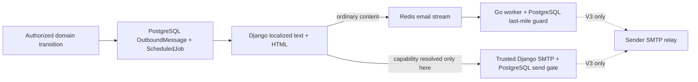

# Waçla V2 — transactional email readiness

Scope: code/local verification only. External sending remains disabled. No
Sender account/credential creation, provider SMTP/API connection, real email,
DNS/mailbox changes, Railway operation, VPS deployment, production migration,
APK, push or merge is part of V2. Only public provider documentation was read.

**Local V2 readiness: PASS. External sending remains disabled. Real delivery is unverified.**

## Baseline and decision

The supplied `work` checkout initially had a clean tree at
`07c2a11111b26357da5ddedc2fa428854c4ee3ee`. After the owner made V1 available,
fetched `codex/v1-vps-readiness`, verified its HEAD as
`b215c5936146e2f0045d74c801e70b1b34e7f36b` and fast-forwarded `work` to it.
V2 is based on that exact V1 commit and inherits the owner's original Waçla
rename. No uncommitted owner files were present or overwritten; main is untouched.

Retain SMTP. Waçla already owns its templates, locales, encrypted capabilities,
durable logical obligations and recovery. Sender REST would not remove the
database/SMTP acceptance ambiguity and introduces an unnecessary provider/API
dependency. `EMAIL_PROVIDER=sender_net` labels the existing generic SMTP adapter;
`smtp` and the existing alias remain compatible with future provider changes.

[Sender's official setup guide](https://www.sender.net/help/transactional-emails/getting-started/)
confirms `smtp.sender.net`, port `587`, STARTTLS, SMTP-user authentication and
verified-domain From identities. Sender's dashboard supplies actual account and
DNS values. No real credentials were obtained or used to verify this contract.



## Audit of current implementation

Inspected the Phase 6A/6C records, current notification renderer/layout/vault,
account and invitation services, handover services, finance/payment/refund/payout
callers, dispute/cancellation transitions, durable job runner/sweeps, published
receipts, Go SMTP/config/stream recovery, Flutter communication fields and V1
runtime/Compose/monitoring. Historical phase documents describe earlier states;
the inventory below follows current callers.

The existing image-free, 600px single-column table layout, Waçla parchment/ink/
terracotta palette and wordmark remain. No new logo, color, webfont, tracking
pixel or third-party asset was added. User-visible subjects, preheaders,
headings, body, CTA, security/footer/support copy use Waçla; historic financial
references such as `ST-<id>`, provider IDs, package names and database records
are preserved.

## Email matrix

Every row uses the same multipart `EmailDocument` implementation in
`apps/notifications/outbox.py` and `email_layout.py`; the Kind column names its
template. All templates, including optional ones, have complete EN/FR/AR copy.

Locale **U** = captured account `preferred_language`; **R** = captured Deal
recipient `communication_language`; **G** = guest-link language selected
explicitly or captured from its owner; **I** = explicit invitation language
selected in the privileged API/console (default EN). Invalid/historical blank
values fall back to EN. No country, name, domain, header or browser inference.

Retry **D** = trusted direct SMTP; **S** = Redis/Go SMTP with durable PostgreSQL
guard. Both share a minute rate budget, exponential backoff and terminal 5xx
classification. Normally 10 attempts; recipient codes have 12. Every obligation
has a unique deterministic key. All rows also obey the pre-activation/age gates
described below. A recipient receives only their own obligation.

| Kind | Existing trigger and authentication/authorization | Recipient / locale | Required allowlisted context / sensitive content | Retry | Idempotency key | Expiration/current-state behavior |
| --- | --- | --- | --- | --- | --- | --- |
| `email_verification` | Public registration; registration throttle; confirmation requires owning OTP under verification throttle | Account email / U | Encrypted reference to hashed owning OTP; no plaintext context | D | `email_verification:{code_id}` | Owning TTL (default 15m), active/latest code, account/email binding; single use |
| `password_reset` | Public throttled reset request; generic 202 prevents enumeration | Matched account email / U | Encrypted reference to hashed reset OTP | D | `password_reset:{code_id}` | Owning TTL (default 15m), active/latest/unused code and account/email binding |
| `admin_invitation` | `manage_admins` creation; only Super Admin may invite Super Admin; acceptance requires capability plus matching account authentication or validated new password | Invited address / I | Role slug and trusted HTTPS public origin; encrypted one-time capability | D | `admin_invitation:{uuid}` | Owning invitation TTL (default 24h, API up to 7d); rejects revoked/used/expired/email mismatch |
| `kyc_status` | Locked approval/rejection by authorized trust administrator | Submission owner / U | Approved/action-required status and bounded reason; no document | S | `kyc_status:{submission_id}:{decision}` | No independent TTL; review historical decision relevance |
| `flight_proof_status` | Locked authorized proof review | Journey traveler / U | Status, reason, journey reference; no proof document | S | `flight_proof_status:{proof_id}:{decision}` | No independent TTL; review superseding proof decisions |
| `payment_required` | Template only; no active enqueue caller | Optional future account contract / U | Payment reference and authoritative EUR cents | S | No active obligation | Remains unwired; V2 adds no payment event |
| `payment_processing` | Template only; transient processing deliberately unwired | Optional future account contract / U | Payment reference | S | No active obligation | Processing/abandoned checkout must not become failure mail |
| `payment_failed` | Authoritative provider/reconciliation transition to actual failed attempt | Order owner / U | Public payment reference, EUR cents, failed status | S | `payment_failed:attempt:{id}:owner` | Pending failure is cancelled on later authoritative success |
| `payment_succeeded` | Template only; no active enqueue caller | Optional future account contract / U | Payment reference and EUR cents | S | No active obligation | Remains unwired; no new customer event |
| `guest_payment` | Actual guest-attempt failure or success through existing payment rail | Guest receipt address / G | Public payment reference, EUR cents, currency and status only; no private Deal/recipient/location | S | `guest_payment:attempt:{id}:{status}` | Failure superseded by success; receipt grants no identity or Deal authority |
| `refund_status` | Existing refund pending/succeeded transition | Owner and actual guest payer, if any / U or G | Public payment reference, refund EUR cents and status; no banking/provider secrets | S | `refund_status:refund:{id}:{status}:{audience}` | No independent TTL; operator reviews old pending/completed snapshots |
| `recipient_delivery_code` | Durable release after stored 30m pickup buffer / authorized handover state machine | Current Deal recipient / R | Recipient/sender display names and reference; sealed handover-code reference | D (12) | `recipient_delivery_code:{deal_id}:{code_id}` | Only active DELIVERY code for this Deal/current recipient; used/rotated/cancelled/buffered codes refuse rendering |
| `pickup_confirmed` | Authenticated Deal traveler submits valid pickup code; owning lifecycle locked | Sender / U | Delivery reference and stored buffer minutes; no handover code | S | `pickup_confirmed:{deal_id}` | No independent TTL; historical action notice requires review |
| `delivery_code_released` | Stored delivery-code release | Sender / U | Delivery reference; tells sender to open app, contains no code | S | `delivery_code_released:{deal_id}:{code_id}` | Historical relevance depends on current handover state |
| `delivery_confirmed` | Authenticated Deal traveler submits valid one-time delivery code; owning lifecycle locked | Sender and traveler / U | Delivery reference and snapshotted protection deadline | S | `delivery_confirmed:{deal_id}:{user_id}` | No independent TTL; does not change protection or payout policy |
| `protection_ending` | Delivery confirmation schedules stored deadline minus reminder interval | Sender and traveler / U | Delivery reference, stored protection deadline, reminder interval | S | `protection_ending:{deal_id}:{user_id}:v1` | Dispute cancels pending reminder/job; passed/invalid deadline refuses dispatch, including expiry while in Redis |
| `protection_ended` | Existing protection close/payout-eligibility transition | Sender and traveler / U | Delivery reference | S | `protection_ended:{deal_id}:{user_id}` | No independent TTL; historical state must be reviewed |
| `dispute_opened` | Existing authorized dispute opening; payout freezes | Sender and traveler / U | Delivery/dispute references; no private evidence | S | `dispute_opened:{dispute_id}:{user_id}` | No independent TTL; no new dispute behavior |
| `evidence_request` | Template only; no domain action currently enqueues it | Optional future dispute contract / U | Dispute reference; directs evidence upload into app | S | No active obligation | Remains unwired |
| `dispute_resolved` | Authorized administrative resolution | Sender and traveler / U | Delivery/dispute references and allowlisted localized resolution | S | `dispute_resolved:{dispute_id}:{user_id}` | Historical outcome notice; no settlement changes |
| `payout_status` | Existing payout eligibility/status/reconciliation notification hooks | Traveler / U | Delivery reference and public payout status; no payout credentials | S | `payout_status:{id}:{status}` or `payout_event:{public_ref}:{state_version}:{event}` | No independent TTL; review current payout state before releasing backlog |
| `deal_cancelled` | Existing authorized cancellation/no-show settlement | Sender and traveler / U | Delivery reference and allowlisted reason | S | `deal_cancelled:{deal_id}:{user_id}` | Historical outcome notice; no economics changed |
| `rating_available` | Existing delivery confirmation and rating-window arming | Sender and traveler / U | Delivery reference and stored review deadline | S | `rating_available:{deal_id}:{user_id}` | Operator must cancel stale review prompts after rating window closes |
| `security_event` | Successful password-reset confirmation | Account owner / U | `password_reset_completed` event only; no recovery/password/session material | S | `security_event:password_reset:{reset_id}` | No independent TTL; existing only credential-change hook; no new account event added |

Verification issuance currently occurs at registration only; this branch has no
self-service verification-resend endpoint. Do not document an expired signup OTP
as reusable, retry registration for an existing account, or set verification flags
to bypass it. Before supporting historical unverified accounts in V3, arrange a
separately authorized fresh issuance using the existing trusted account helper,
or explicitly scope a resend support/API workflow. V2 adds no new customer event.
Password reset already has its public throttled fresh-request contract.

## Localization, branding and mobile integration

One translated document supplies subject, preheader, headings, paragraphs,
highlight, facts, CTA, notices and both body alternatives. Invitation strings
and role labels now join the complete FR/AR catalogues; the earlier deliberate
English-only exception is removed. Its explicit `communication_language` field
is additive in the API/console, and replacement invitations retain the chosen
locale. OTP/invitation copy shows the actual stored UTC expiry rather than
claiming a fresh fixed lifetime after a delayed send.

The browser audit found a long French delivery-confirmation fact label forcing
horizontal overflow on a narrow screen. Facts now use bounded wrapping columns;
the outer table has an inline fluid width capped at 600px, so removing the head
style block retains a mobile layout. Existing palette/structure/wordmark remain.
All 24 templates × three locales × 320/390/800px × normal/inline-only styles
pass **432 Chromium probes** with long public references. Reviewed Arabic code/
invitation and French delivery screenshots. This is local browser evidence,
not Outlook/Gmail/Apple inbox certification.

Arabic sets document/body RTL, right alignment and mirrored borders/padding;
codes/URLs and EUR facts retain LTR isolation. Dynamic fields are HTML escaped;
invitation origins reject unsafe schemes, credentials, query strings and
fragments, and invitation tokens are URL encoded. The previously unresolved invitation CTA
now reaches a localized browser GET/POST page using the existing one-use service.
New links keep the token in a URL fragment; script moves it to a hidden POST
field and clears the address bar. GET never resolves or consumes a capability.
CSRF, the existing login throttle, email-based authentication for existing
accounts, account binding, generic errors, no-store/no-referrer and nonce CSP
protect acceptance. No credentials are returned or account automatically logged
in. The existing admin CIDR restriction still applies: V3 must provide invited
staff access through the approved admin network. The outer proxy preserves
stricter application referrer policies.

Flutter already exposes account language in signup/Google/profile flows,
recipient communication language, guest-link communication language and payer
receipt email. Confirmed their repository serializers/wire fields. No essential
mobile field is missing, so no Flutter runtime, generated mobile localization
or screen redesign was needed. Historical blank language fallback is unchanged.

## Security, reliability and backlog changes

* Registration and reset issuance now commit the account/capability and email
  obligation atomically. Failure-injection tests exposed previously committed
  user/code rows when outbox creation failed; the transaction now rolls back
  the whole issuance. No new email event or payment behavior was introduced.
* Reset redemption now checks the latest issued row (deterministic timestamp/PK
  ordering), including consumed rows. A successful newer reset cannot reactivate
  an older unused code. This matches the trusted email-delivery eligibility gate.
* Preserved the secret vault/handover seal and trusted final rendering. Codes
  never enter Redis, durable context, published-event payloads, notifications,
  generic logs or ordinary administrative listings. Secret-shaped context keys are rejected.
* Added capability-to-obligation and account/email/Deal/recipient checks;
  used/superseded OTPs and revoked invitations cannot be rendered from a still
  encrypted delivery copy. Rendering itself changes no authentication state.
* Django now stores fixed failure codes, raises safe job errors, distinguishes
  transient/timeout from permanent 5xx rejection, and respects retry deadlines.
  Failures commit before the safe exception reaches the job runner.
* A shared transaction-scoped PostgreSQL advisory lock covers the bounded final
  send and outcome commit. Concurrent workers cannot race the SMTP send for an
  obligation; process loss releases the lock automatically. Go rechecks row
  state/recipient/kind, activation, retry and rate eligibility, records SMTP
  acceptance or classified failure, then ACKs Redis. Orphan/obsolete stream
  entries cannot become independent sending obligations.
* Ordinary claims and receipt handles now commit before Redis publication.
  Publication never overwrites a fast consumer's accepted/failure state, including
  an ambiguous Redis reply. Separate-connection regressions prove visibility and
  preserve both accepted and transient outcomes. A committed claim's receipt
  deadline also excludes concurrent publishers. Ordinary publication does not
  take the global final-SMTP gate.
* Go drains one SMTP handler at a time per process because final sends already
  serialize globally. A real Redis/PostgreSQL/SMTP burst test handles 20/20
  immediately; the prior 32-handler configuration only handled 4/20 before
  unnecessary pending-entry deferral. Multiple workers remain safe under the
  shared database gate.
* Added bounded Go socket handling after a deterministic stalled-greeting test
  exposed an unbounded read in the library's configured timeout. The entire
  connection, including greeting, TLS and QUIT, now has a hard deadline. Mandatory
  STARTTLS never falls back to plaintext. Django uses its existing 10-second
  socket timeout; Go additionally caps the entire connection at 10 seconds.
  The existing Go 12s send + 3s ACK fits its 15s drain window.
* Shared rate default 60/minute includes successful and classified failed sends.
  Indexed aggregate queries and nonblocking locking keep overload retryable.
  SMTP failure backoff starts at 60s, doubles and caps at 6h. No new scheduler.
* Existing job sweeps, receipt checks, Redis restart/group recreation and PEL
  reclaim remain. Stable Message-ID aids retry correlation. Exactly one logical
  obligation does **not** mean exactly-once SMTP delivery: the acceptance/commit
  crash gap can duplicate a message. `dispatched`/legacy `delivered_at` mean SMTP
  acceptance, not inbox placement. Final delivery/bounces require V3 provider
  evidence; no fictional delivered webhook contract was introduced.
* Added nullable `activation_reviewed_at` and rate-query indexes through two
  additive Django migrations; regenerated the PostgreSQL schema. No historical
  rows are rewritten. No sqlc output exists because query directories are empty.
* A mandatory production activation cutoff holds older unreviewed obligations;
  a separate 48-hour age gate handles prolonged outages. Explicit per-row
  releases expire after 24h. Read-only audit and privileged fingerprint-bound
  release/cancel commands preserve audit evidence and never send. Expired/
  obsolete capabilities, accepted receipts and exhausted retry budgets cannot
  be blindly released. Held rows cannot starve the normal sweep.

Full procedure, human current-state checks, DNS/SPF/DKIM/DMARC preparation,
Namecheap-compatible mailbox recommendations, secret injection, monitoring,
rotation and V3 activation checklist: [infra/vps/EMAIL.md](../infra/vps/EMAIL.md).
Neither historical backlog command was run against Railway or any owner database.

## Verification

Use disposable local PostgreSQL 16, Redis 7 and loopback-only SMTP sinks. The
repository V1 integration fixture creates random project names/credentials,
isolated volumes and local TLS, then removes its own resources. No Sender
network request is needed or permitted in these tests. New SMTP sinks accept
only test addresses; no external recipient is contacted.

| Gate | Command / conditions | Result |
| --- | --- | --- |
| Full Django regression | `pytest --ds=config.settings.dev -q -n 2 --create-db --reuse-db --durations=15`, CI throttle ceilings, local PostgreSQL, `EMAIL_ENABLED=false`, TEST/mock fixtures only | **2,520 passed, 34 retired-contract skips**, 24 existing warnings, 2,114.90s. Final account/email changes were followed by the complete affected-suite rerun below |
| Focused final email/authorization/ops/startup | `pytest -q --reuse-db apps/accounts/tests apps/notifications/tests apps/admin_panel/tests/test_phase6a_admin.py apps/admin_panel/tests/test_v2_invitation_web.py apps/finance/tests/test_deployment_safety.py`; same local settings | **349 passed**, 0 skips, 1 existing warning, 68.13s after the final account atomicity/latest-code fixes. Earlier responsive-only rerun: **212 notification tests passed** (101.25s) |
| Full Go unit/race | `go test -race -count=1 ./...` in `backend/services` | **14 test packages passed**, 5 command/generated packages have no tests |
| Full Go integration/race | `REDIS_TEST_URL=<local-db14> EMAIL_TEST_DATABASE_URL=<disposable-loopback-wacla> go test -tags integration -race -count=1 -v ./...` | **14 test packages passed**, 234 top-level passing test results, **0 skips** |
| Go build/vet/format | `go build ./...`, `go vet ./...`, `gofmt -l` | **Passed**, no unformatted Go files |
| VPS unit/configuration | `python -m unittest discover -s infra/vps/tests -p 'test_*.py'`; Compose config | **29 passed**; production/local Compose resolves with generated fixture secrets, no public data/app ports |
| VPS production integration | `WACLA_TEST_IMAGE=wacla-v2-test:<runtime-sha> WACLA_BACKUP_TEST_IMAGE=wacla-backup-test:<runtime-sha> python infra/vps/tests/integration.py` | **9/9 groups passed** on the final runtime images. Covers: durability, migrations/startup, proxy routes/TLS/WS/auth/CIDRs, process restart, invitation headers, encrypted backup/isolated restore/corruption refusal; own volumes removed |
| Ruff / system / migrations / schema | `ruff check backend/monolith backend/railway/start.py infra/vps tools/preview/check_email_layout.py`; preview formatter check; `manage.py check`; `makemigrations --check --dry-run`; normalized PostgreSQL export comparison | **Passed**, no migration/schema drift; sqlc explicitly inapplicable because all query directories are empty |
| Localization | All 24 kinds × EN/FR/AR/fallback, catalogue completeness/placeholders, text/HTML/RTL assertions, deterministic MO compilation; mobile ARB parity | **Passed**; FR/AR MO reproducible, **1,466** mobile messages per locale match EN; existing static web/edge checks also pass |

Browser reproduction (optional local test tools; no application dependency):
install Playwright into a test environment, use an installed Chromium, then run
`PYTHONPATH=backend/monolith DJANGO_SETTINGS_MODULE=config.settings.dev python tools/preview/check_email_layout.py --chromium /usr/bin/chromium`.
`--screenshots <private-local-directory>` exports representative samples. The
harness uses unsaved objects, a fixed fake capability and reserved origins,
blocks every page request, and performs no database write or SMTP operation.

The Go integration CI job now provisions disposable PostgreSQL and loads the
Django-owned schema, so the new last-mile database tests run rather than skip.
The final runtime source is `813d4564f1d1628a6341aa458bd20974fad7a4e6`.
Its image was built from `git archive` of that exact commit (no working-tree
substitution):

* Application `wacla-v2-test:813d4564f1d1628a6341aa458bd20974fad7a4e6`:
  `sha256:0d3e45413263bbad2bb74b2f42323c0ef8ffbccbe02833f12030ea91cc5402f2`.
* Backup `wacla-backup-test:813d4564f1d1628a6341aa458bd20974fad7a4e6`:
  `sha256:7e6145c69ec1e1dfcf7c485d34651695ac71575ef5532017798611d8f9b478f8`.

The later documentation commit changes no tested runtime files.
No separate Gemini workflow was used. Fixed defects include the stalled SMTP
greeting, uncommitted publisher/consumer handoff, burst lock contention,
obsolete capability rendering, missing capability references, guest receipt
reference fallback, untranslated invitation roles/copy, the unresolved invitation
CTA and its email-versus-username authentication mismatch, missing current-state
backlog facts, malformed/overflowing capability references, both proxy layers
overriding private referrer policies (fixed in the VPS renderer without changing
Railway), unsafe exception persistence, and inconsistent sender/Reply-To
configuration. The local image regression also found source-mode sensitivity in
the non-root backup image; its script COPY now sets explicit read permissions.
Failure injection also proved/fixed non-atomic signup/reset issuance and older
reset-code reactivation (three reproducing failures before the fix).
Local browser tests found/fixed French facts overflow and missing fluid inline
fallback. Regression checks cover these paths.

The 34 full-suite skips are existing, explicitly retired contracts: 10 legacy
Trip create/search tests and 24 traveler-first/DZD matching/counter tests. No V2
email, PostgreSQL concurrency or Go integration case is skipped. A final full
rerun initially could not create test data because disposable Docker build cache
filled the 32 GB workspace disk. The run was stopped, only generated V2 images/
build cache were reclaimed, and the complete checks were restarted with ample
free space. This was a test-host resource failure, not a delivery result.

Unperformed by design: real Sender delivery/DNS/provider activation, real mailbox
creation, public-domain TLS/client-inbox certification, Hetzner provisioning/
deployment, production migration, Railway operations and LIVE financial tests.
Flutter analyzer/tests are not an affected-change gate because no mobile files
changed; existing integration fields were inspected and localization parity checked.

## Owner decisions and V3 work

Owner supplies domain/public origin, monitored support/contact ownership, From
identity, mailbox provider/plan, Sender account/limits, DMARC reporting/policy,
operational alert destination, fresh-verification support policy for legacy
unverified accounts, native FR/AR copy review and approved live test
recipients. V3 creates credentials and mailboxes, authenticates DNS, reviews
every historical obligation, deploys the reviewed commit through V1 procedures
and performs controlled received-email/bounce/reply testing. Keep Stripe TEST,
Chargily TEST, `PAYMENTS_ENVIRONMENT=test`, DZD execution and automatic payout
switches off. No ledger, payout policy, reconciliation economics or payment
idempotency was changed for V2.

**No claim of real Sender.net delivery is made.**

## Changed-file inventory

63 files changed relative to the verified V1 baseline; no mobile, landing-site,
ledger, payout-rule or payment-provider implementation was changed.

```text
.github/workflows/ci.yml
backend/.env.example
backend/contracts/sql/schema.sql
backend/monolith/apps/accounts/tests/test_v2_email_obligations.py
backend/monolith/apps/accounts/views.py
backend/monolith/apps/admin_panel/console_forms.py
backend/monolith/apps/admin_panel/console_views.py
backend/monolith/apps/admin_panel/invitation_web.py
backend/monolith/apps/admin_panel/serializers.py
backend/monolith/apps/admin_panel/services.py
backend/monolith/apps/admin_panel/tests/test_v2_invitation_web.py
backend/monolith/apps/admin_panel/views.py
backend/monolith/apps/core/ops_snapshot.py
backend/monolith/apps/finance/jobs.py
backend/monolith/apps/notifications/backlog.py
backend/monolith/apps/notifications/delivery_policy.py
backend/monolith/apps/notifications/email_layout.py
backend/monolith/apps/notifications/management/commands/audit_email_backlog.py
backend/monolith/apps/notifications/management/commands/review_email_backlog.py
backend/monolith/apps/notifications/migrations/0006_outboundmessage_activation_reviewed_at.py
backend/monolith/apps/notifications/migrations/0007_outboundmessage_outbound_accepted_idx_and_more.py
backend/monolith/apps/notifications/models.py
backend/monolith/apps/notifications/outbox.py
backend/monolith/apps/notifications/tests/test_outbox.py
backend/monolith/apps/notifications/tests/test_v2_configuration.py
backend/monolith/apps/notifications/tests/test_v2_readiness.py
backend/monolith/config/settings/base.py
backend/monolith/config/settings/prod.py
backend/monolith/config/urls.py
backend/monolith/locale/ar/LC_MESSAGES/django.mo
backend/monolith/locale/ar/LC_MESSAGES/django.po
backend/monolith/locale/fr/LC_MESSAGES/django.mo
backend/monolith/locale/fr/LC_MESSAGES/django.po
backend/monolith/templates/admin/invitation_accept.html
backend/services/cmd/email/main.go
backend/services/internal/email/consumer.go
backend/services/internal/email/readiness_integration_test.go
backend/services/internal/email/readiness_test.go
backend/services/internal/email/receipts.go
backend/services/internal/email/sender.go
backend/services/internal/email/smtp_sender.go
backend/services/pkg/config/config.go
backend/services/pkg/config/config_test.go
backend/services/pkg/config/email_readiness_test.go
docs/IMPLEMENTATION_STATUS.md
docs/PHASE6A_ADMIN_EMAIL_LANDING.md
docs/PHASE6C_TRANSACTIONAL_EMAIL_LOCALIZATION.md
docs/V2_EMAIL_READINESS.md
infra/vps/Caddyfile
infra/vps/EMAIL.md
infra/vps/ENVIRONMENT.md
infra/vps/app-secrets.example.json
infra/vps/backup/Dockerfile
infra/vps/monitor.py
infra/vps/render_internal_caddy.py
infra/vps/runtime.py
infra/vps/stack.env.example
infra/vps/tests/integration.py
infra/vps/tests/test_email.py
infra/vps/tests/test_monitor.py
infra/vps/tests/test_safety.py
infra/vps/vps
tools/preview/check_email_layout.py
```
