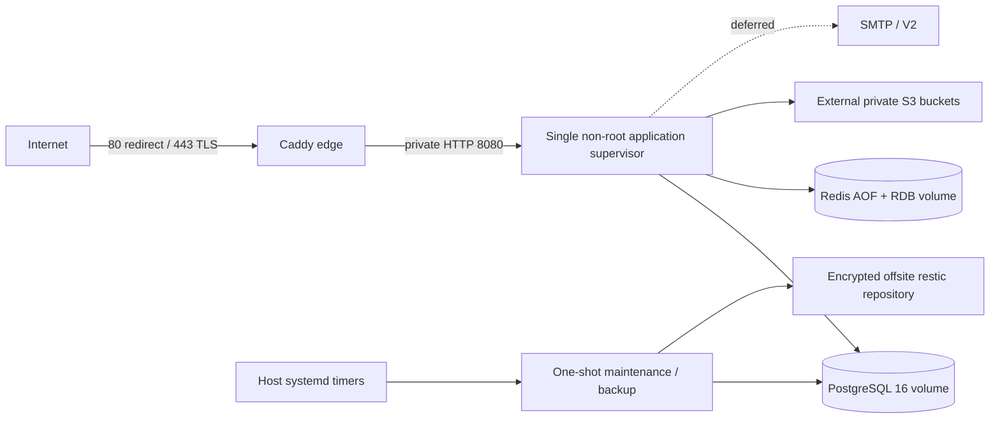

# Waçla VPS foundation (V1)

This directory prepares code for one Ubuntu 24.04 x86-64 Hetzner VPS with
8 shared vCPUs, 16 GB RAM and approximately 160 GB disk. It does not provision,
deploy, change DNS or activate providers. Read the audit and verification record
in [V1_VPS_READINESS](../../docs/V1_VPS_READINESS.md) before V2/V3.

Use Python 3.12 and Docker Compose 2.24.4 or newer (`!override` is used only by
the local test override). Cloud verification uses Docker 28.4.0 / Compose 2.40.3.

## Architecture and ownership



`app` retains the K6 single-unit decision, with four Gunicorn workers and two
threads, Django KYC gRPC, one reservation releaser, one finance worker, Go chat,
notification, KYC and email, and the existing internal Caddy/static website.
It is deliberately **one replica**. The finance loop already owns notification
dispatch, email outbox retries, FCM results and all database-scheduled lifecycle,
refund, reconciliation and payout work. Do not add another scheduler for those.
Email remains parked (`EMAIL_ENABLED=false`). An exited child fails the unit;
there is no silent partial startup. The optional embedded Redis is forbidden.

Separate Compose services are `postgres`, `redis`, `app`, `caddy`, and the
one-shot `maintenance` and `backup` operations profile. There is no cron, worker
or scheduler hidden in either operations image. Host daily maintenance only runs
JWT blacklist cleanup, existing detection-only event reconciliation and explicitly
approved retention commands. It never starts finance or reservation loops.

The private `data` network has no external routing. PostgreSQL and Redis have no
published ports and belong only to it. The application also has an outbound
bridge for external storage/providers. The edge has no database network or app
secrets. Only TCP 80 and 443 are published. Internal application, gRPC, metrics
and admin service ports are never published. No container receives a Docker socket.
Named volumes preserve PostgreSQL, Redis and Caddy certificate state.

## V3 preparation on the eventual server

1. Have the owner approve server, operator identity/SSH source addresses, domain,
   storage buckets, backup repository, recovery objectives and retention choices.
   Copy the reviewed repository to `/opt/wacla`, then run
   `python3 /opt/wacla/infra/vps/vps prepare-config`. It sets only the four tracked,
   non-secret bind-mounted configs to 0644 even with a restrictive Git umask;
   rerun it after future checkouts. Never copy a working tree holding
   real credentials. The original Waçla rename is already retained in this
   branch's history; see the audit for the starting-checkout reconciliation.
2. Review `bootstrap.sh --help`. During V3 only, run `bootstrap.sh setup USER
   PUBLIC_KEY_FILE SSH_SOURCE_CIDR PUBLIC_INTERFACE` as root. It installs Docker,
   Compose, security updates, fail2ban, host firewall and a Docker forwarded-port
   guard. Bootstrap writes deployment-user identity drop-ins for the four CLI-based
   systemd units, so timers and interactive commands own the same state files.
   The dedicated user has root-equivalent Docker access and passwordless
   sudo. Keep this group limited to trusted operators. Package updates can restart
   services: run setup in a reviewed maintenance window. After setup, ensure the
   reviewed `/opt/wacla` checkout belongs to this deployment user; copy/check out
   its files using that account. Bootstrap changes the top directory's ownership,
   not an existing tree's files. A root-owned checkout made with umask 077 would
   otherwise prevent the deployment user and systemd units from reading it.
3. Keep the original SSH session open. In a **second** session prove the user's
   SSH key and sudo work. Only then run `bootstrap.sh harden-ssh
   --key-access-confirmed`. That explicit assertion is the operator's confirmation;
   setup itself never disables password/root login. Review existing SSH drop-ins
   and existing firewall allow rules; the script preserves them instead of
   resetting someone else's policy. Test recovery-console access.
4. Copy `stack.env.example` to `/etc/wacla/stack.env`, `backup.env.example` to
   `/etc/wacla/backup.env`, and `app-secrets.example.json` to
   `/etc/wacla/secrets/app.json`. Replace every placeholder. Set `STACK_ENV_FILE`
   and `BACKUP_ENV_FILE` to those absolute paths. Values are literal unquoted
   `KEY=value` entries, never shell commands. Space-separated Admin CIDRs and
   WebSocket origins are supported. Secret values belong in JSON/files.
5. Generate **distinct** secrets using `openssl rand -hex 32`; save database,
   Redis and restic passwords as `postgres-password`, `redis-password` and
   `restic-password` in the secrets directory. Existing authentication/encryption
   secrets must be securely transferred unchanged for migration, rather than
   regenerated. Keep the restic password in an independent owner-controlled vault;
   losing the VPS and the only password copy loses the backups too.
6. Set the secrets directory group to GID 10001 (`wacla-runtime`), mode 0750.
   Set all four mounted files (`app.json`, `postgres-password`, `redis-password`,
   `restic-password`) to mode 0640/GID 10001 so
   the non-root application/backup containers can read their own mounted secrets. The owner is the trusted
   deployment operator. Set both env files and operator state files
   to 0600; keep the operator state directory at 0700. Never grant other users membership in the runtime group. Compose
   local secrets are bind mounts, **not an encrypted secret store**; ownership is
   enforced on host files, because local Compose ignores secret UID/mode remaps.
7. Use a full reviewed 40-character Git SHA for `RELEASE_ID` and image tags, or a
   digest for image references. Build only a clean tree at that SHA. The build
   command uses a Git archive to exclude ignored/untracked owner files and refuses
   pre-existing tags. Record resulting image IDs/digests and retain
   the prior image; never prune images/volumes as an update step.

`bootstrap.sh` does not start the application or enable operational timers.
It is intended for a fresh server. It preserves data, authorized keys, Docker
configuration and unrelated firewall policy. Review existing GID 10001 conflicts
before running. Debian/Ubuntu package repository changes are V3 network operations.
The public interface guard applies to IPv4 Docker forwarding; this stack does not
enable Docker IPv6 networking or publish UDP/QUIC. Validate both IPv4 and IPv6
exposure on the actual server before opening traffic. After reviewing the merged
Docker daemon configuration, run `dockerd --validate --config-file
/etc/docker/daemon.json`, then rehearse a Docker restart in the V3 maintenance
window so daemon-level logging defaults take effect. Compose also sets explicit
per-container rotation independently.

## Configuration contract

The full variable reference is [ENVIRONMENT.md](ENVIRONMENT.md). The production
Django settings remain authoritative and fail closed; V1 runtime adds TEST-only
and email-off restrictions. There is one secret JSON source plus two shared
password files, not parallel Django/Go database URLs. `REDIS_URL` is derived once
from the password file and the `redis` service, then inherited by every consumer.
`DATABASE_URL` and a second route-cache URL are refused.

`vps validate` checks placeholder replacement, image references, critical V1
switches, dedicated secrets, file permissions, host/origin shape, backup shape
and Compose syntax. It does not contact storage or payment providers. It does not
prove offsite permissions or TLS reachability; explicit backup/restore and V3
provider checks are separate gates. Never print `docker compose config` with a
secrets-bearing env file; use `config --quiet`.

## Release commands

The following are **future V3 commands**, not actions authorized in V1:

```sh
# Run as the dedicated deployment user, including timer/boot commands.
export WACLA_CONFIG=/etc/wacla/stack.env
export WACLA_STATE=/var/lib/wacla
VPS=/opt/wacla/infra/vps/vps
$VPS prepare-config          # only tracked non-secret config files; secrets untouched
$VPS validate
$VPS build
# First server only: start the two dependencies explicitly before migrations.
docker compose --env-file "$WACLA_CONFIG" -f /opt/wacla/infra/vps/compose.yml up -d --wait postgres redis
$VPS migrate
$VPS catalogue
$VPS backup-init              # explicit once; never automatically recreate a repository
$VPS backup
$VPS snapshots                # select/copy full immutable snapshot ID
$VPS verify FULL_SNAPSHOT_ID
$VPS restore FULL_SNAPSHOT_ID # disposable isolated database, never a production target
$VPS start
$VPS health
$VPS logs
```

Initial application startup refuses unapplied migrations. Ordinary restarts never
run migrations or catalogue imports. `migrate`/`catalogue` use a PostgreSQL session
advisory lock shared by all maintenance containers; a second operator fails rather
than running concurrently. Migrations remain Django-owned. Never manually edit
financial tables or schema contracts. A restored deployment retains its existing
Admin accounts, granular roles, revocations and active business policy; do not
recreate them or reset their credentials. For a genuinely empty installation,
the existing controlled `bootstrap_super_admin` management command is a separate
V3 operator step with owner-supplied temporary credentials and an audited account
identity. It is deliberately absent from automatic startup and daily maintenance;
review that procedure and policy initialization before enabling public access.
Geography import uses the bundled reviewed
manifest with `--skip-if-current`, without `--deactivate-missing`.

To update, first rehearse the migration plan, backup restore and **old image
against the new schema** on disposable data. Review expand/contract compatibility;
no script can infer semantic migration reversibility. Build the new image on a
clean reviewed checkout, update `/opt/wacla`, rerun `$VPS prepare-config`
and invoke:

```sh
$VPS deploy wacla-app:FULL_NEW_GIT_SHA FULL_NEW_GIT_SHA
```

The CLI validates/probes the repository before quiescing the edge and application,
takes an encrypted backup, runs production checks, serial migrations and catalogue
import, then starts and waits for readiness. This is a short maintenance-window
update, **not zero downtime**. There are never overlapping finance writers.
Image rollback does not reverse migrations:

For registry releases, obtain the reviewed image with `docker pull` by digest
before invoking deploy; deploy itself requires the exact image to be present.
Never build using a digest as a tag or replace an existing SHA tag with new bytes.

```sh
$VPS rollback --schema-compatibility-reviewed
```

Use that flag only after rehearsal proves the stored recovery image supports the
current database schema. If incompatible, keep writes stopped and use the reviewed
recovery plan; do not restore over the live database. Release state records current,
previous and unfinished-deploy source/target. A failed deploy blocks ordinary start
and another deploy; explicit reviewed rollback recovers its source release. It
does not guess an older version. Automatic rollback after partially applied
migrations is intentionally absent. Never hand-edit state to bypass this guard.

`stop` drains the edge/app then Redis/PostgreSQL without removing volumes. The
supervisor sends TERM to children and allows its existing 20-second child budget;
Docker grants 40 seconds to the unit and 60 to stateful services. An unfinished
long finance unit may be reclaimed by the existing durable job recovery; do not
assume exactly-once network side effects. Provider idempotency and transactions
remain authoritative. `on-failure:5` bounds consecutive crash retries (Docker can
reset its retry count after a sufficiently healthy run); unhealthy status alone
does not restart a container. Monitoring is necessary. The host stack unit is
linked with `PartOf`/`WantedBy=docker.service` to reactivate after daemon restarts.
That actual Ubuntu/systemd restart sequence must be rehearsed in V3.

## Backup and recovery

`backup` streams `pg_dump --format=custom` directly into restic's command-input
mode. A failed dump fails the snapshot. There is no database-sized RAM buffer or
plaintext staging file in the backup container. restic encrypts/authenticates
metadata and chunks; SHA-256 content IDs provide checksums. Dedicated offsite
credentials must be scoped to the backup bucket/repository, never media buckets.
External destination credentials and the encryption password are never in images.
`BACKUP_KEEP_*` are required positive owner-selected recovery-point counts. Prune
runs only after successful upload and repository check; do not share the
`wacla-postgres` tag/host with unrelated backups. V3 should consider separate
restore/admin credentials and bucket object-lock/versioning to protect against
an attacker with repository delete permission. Set and test the bucket's policy.

`verify ID` reads all repository data, authenticates it, and checks the archive TOC.
`restore ID` exports the verified archive into an independently created Compose
project whose only network is internal and whose database name/user are fixed to
`restore_verify`. It accepts **no destination hostname/database parameter**. It
never attaches production volumes or networks and removes its own volume after
verification. A successful import is necessary but also compare migrations, counts,
ledger sums, provider uniqueness, unresolved jobs and encryption-key decryptability
on an isolated real-data rehearsal in V3. Record recovery point/time and owner signoff.
Do not replace these checks with a Hetzner snapshot.

Backup runs as UID/GID 10001 with read-only root filesystem and no capabilities.
Its named status volume is initialized with that owner by the image; mounted secret
files need GID 10001/0640 and traversable private parent directories. The app never
receives the backup encryption key or backup credentials.

The backup image is independently usable on a trusted recovery host, without
Django, running application containers or the operator CLI. Supply backup-only env
and password file; `verify`/`export` do not require source database credentials:

```sh
docker run --rm --read-only --env-file /secure/backup.env \
  --mount type=bind,src=/secure/restic-password,dst=/run/secrets/restic_password,readonly \
  --tmpfs /tmp:size=128m \
  --tmpfs /work:uid=10001,gid=10001,mode=0700,size=1m \
  --tmpfs /status:uid=10001,gid=10001,mode=0700,size=1m \
  -e RESTIC_PASSWORD_FILE=/run/secrets/restic_password \
  wacla-backup:REVIEWED_GIT_SHA verify FULL_SNAPSHOT_ID
```

For `backup`, additionally supply approved `PGHOST`, `PGPORT`, `PGUSER`,
`PGDATABASE` and bind the source password file at `/run/secrets/postgres_password`.
Reach the database only over an approved private network; publish no database port
to make this work. This is preparation documentation, not V1 offsite access.

The host restore command temporarily stages its decrypted archive inside a private
0700 temporary directory and deletes it on exit. Allow disk for one dump plus the
isolated restored database, and use encrypted host storage if policy requires it.
Do not copy decrypted files into the repository, public web root or a shared folder.

## Monitoring and scheduling

During V3 copy `systemd/*` to `/etc/systemd/system/`, review paths and schedules,
and use `systemctl cat wacla-stack wacla-backup wacla-scheduled wacla-monitor`
to confirm bootstrap's `10-deployment-user.conf` drop-ins select the dedicated
deployment user/group. Never run some CLI commands as root and others as that
user: state ownership is checked before taking an operation lock. Firewall/alert
units retain their required host identity. If provisioning manually, create these
`[Service] User=...` / `Group=...` drop-ins before enabling any CLI-based unit;
then `systemctl daemon-reload`. Enable `wacla-stack.service` only after initialization
and restore evidence. Enable the backup, scheduled and monitor timers explicitly;
none is enabled by this repository or bootstrap. Daily backup/maintenance times are
UTC in the unit files, independent of the owner's display timezone. Choose a backup
cadence/RPO in V3; the provided daily schedule is not a PITR promise. RPO for an
every-second Redis AOF after a hard host crash is approximately one second;
host/volume loss needs a separate Redis transport recovery plan (restore from backup).

`monitor` is host-only. It checks container health, memory, disk, Redis AOF/RDB status,
HTTP error ratio, financial/email/stream backlogs, connection pressure, missing
finance snapshots and backup freshness, returning nonzero and aggregate JSON on a
problem. It may run during a backup and holds no destructive-operation lock.
Logs rotate at 10 MB × 5 per container. Existing `http_request`, `ops_snapshot`,
`ws_stats` and `email_stats` give route-template timing, worker and backlog evidence;
no raw Caddy/Gunicorn access log is enabled because guest capabilities can appear
in URLs. Deep diagnostics remain behind Admin IP controls **and** existing granular
Django authorization. Admin CIDRs are actual source IPs; spoofed proxy headers do
not authorize clients. No public monitoring dashboard or metrics service is added.

`wacla-alert@.service` currently writes to the local journal only. In V3 attach an
approved external alert channel and uptime monitor; no external alerts/email are
activated in V1. A dead host cannot alert itself. Pending email with V1 sending off
is expected but visible, not a reason to quietly enable SMTP. Disk >80%, memory
>85%, DB connections >70%, jobs overdue >600s, stream lag >100, 5xx ratio >1%,
missing worker snapshot and backup >26h are starting operational thresholds to
calibrate on the real VPS. Measure host CPU/load/RAM and existing Go worker stats.

## Local verification and troubleshooting

```sh
python -m unittest discover -s infra/vps/tests -p 'test_*.py'
SHA=$(git rev-parse HEAD)
docker build -f infra/vps/Dockerfile -t "wacla-v1-test:$SHA" .
docker build -f infra/vps/backup/Dockerfile -t "wacla-backup-test:$SHA" infra/vps
backend/.venv/bin/python infra/vps/tests/integration.py
```

Managed-cloud builds additionally need `--secret
id=system_ca,src=/etc/ssl/certs/ca-certificates.crt`; preserve runtime proxy settings.
The CA is a BuildKit-only mount, not an image layer. Local tests create random
project names, credentials, private volumes and a local Caddy CA. They use the
production Django security profile; `compose.local.yml` binds the gateway to
loopback high ports and uses `tls internal`, without public DNS/ACME. Test-only
overrides attach DB/Redis to an outbound bridge with randomly mapped loopback ports
so host test clients can connect. The production file never publishes them.
The fixture supports `WACLA_KEEP_TEST_STACK=true` for diagnosis; remove **only its
recorded random test project** after use. Never run `down --volumes` on production.

For permission failures check host GID 10001 and 0640 secret files; do not chmod
secrets world-readable. For startup failures inspect bounded dependency health,
production config and migration status. `depends_on` waits for defined health
checks only at startup; it does not continuously supervise dependencies. Redis
outages remain visible as `readyz` degradation while security gates fail closed.
If restarts exhaust, inspect logs/cause before `start`. Never use `FLUSHDB`,
`FLUSHALL`, `cache.clear()`, schema reset, volume prune or database recreation
to repair this stack. Failed backup/restore is a release blocker. Keep access
credentials, certificate private keys and database dumps out of diagnostics.
